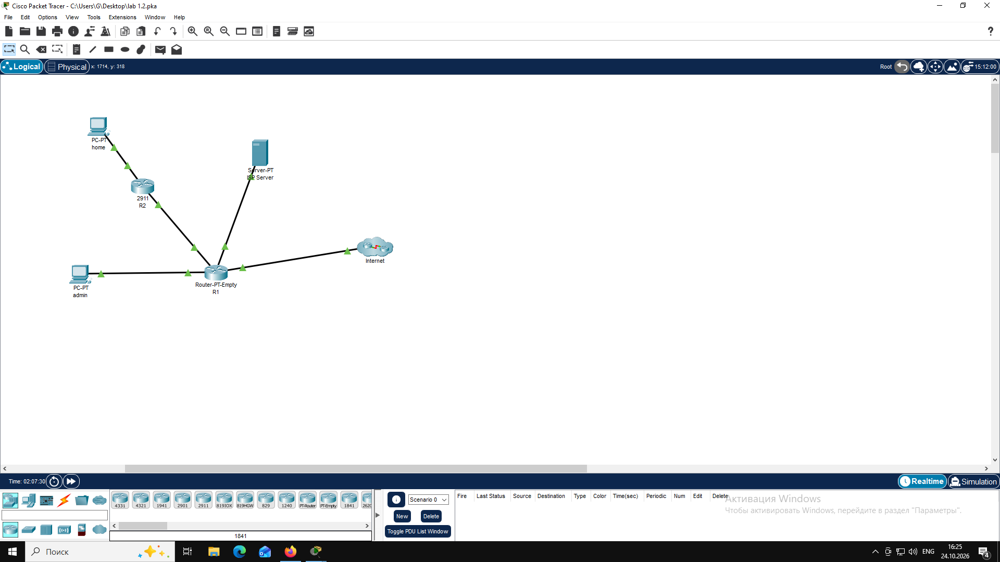
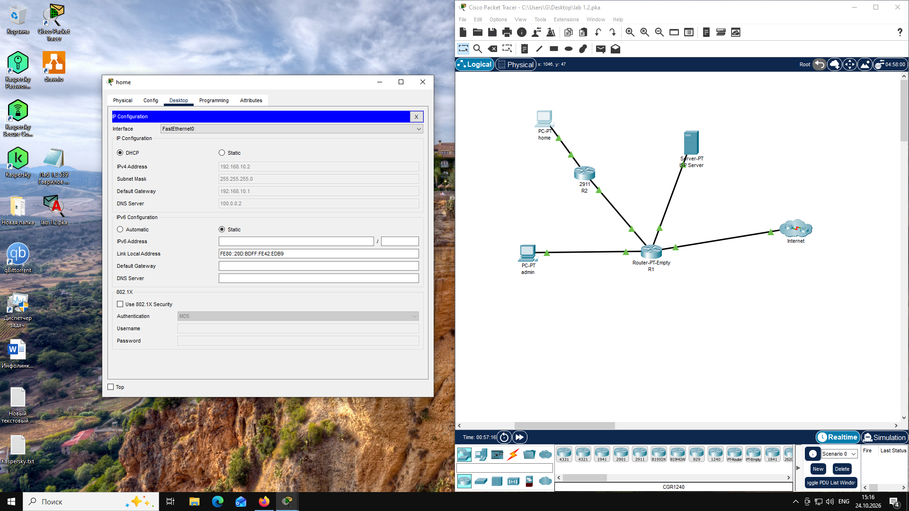

# Пример отчета

````markdown
# Отчет по лабораторной работе №N
**Тема:** Тема работы
**Выполнил:** Иванов И. И., гр. ИВТ-21  

## Топология



## Ответы на вопросы

1. Ответ на вопрос.
2. Ответ на вопрос.
Продолжение ответа.
```text
тут должен быть листинг команд
```
3. Ответ на вопрос.


````